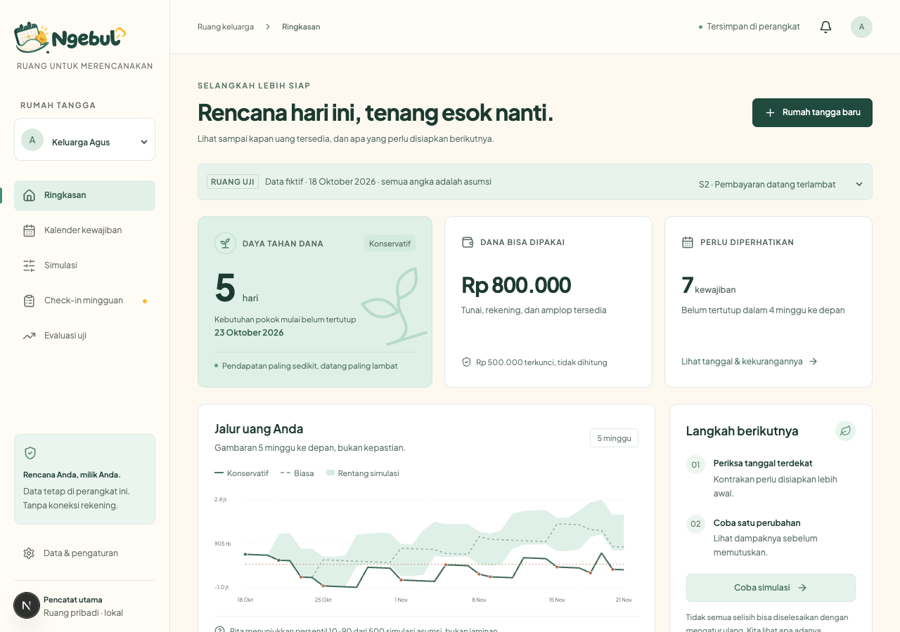
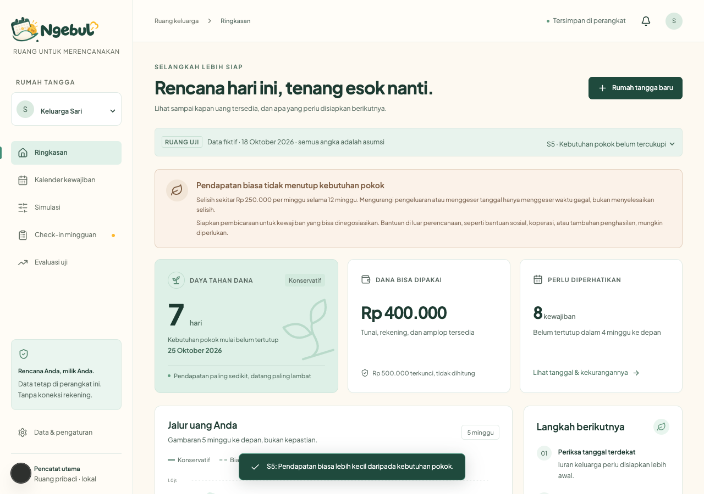
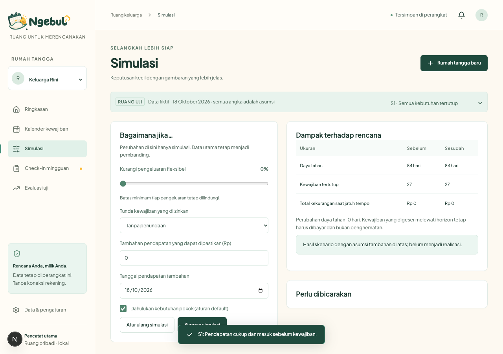
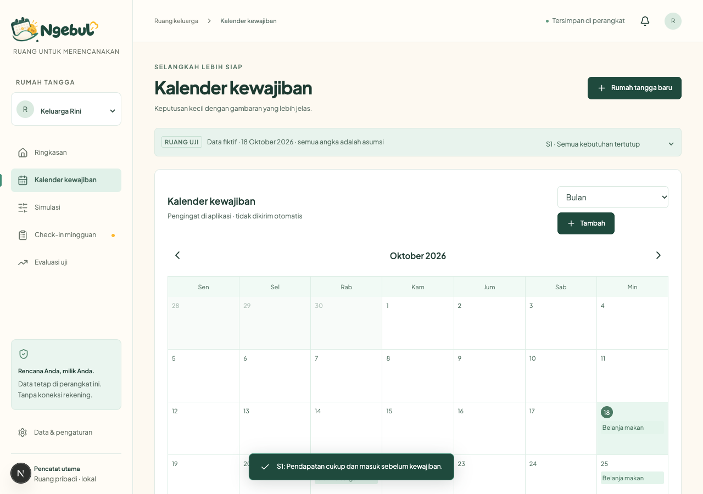

# Ngebul

MVP perencana arus kas rumah tangga berpendapatan tidak tetap. Pertanyaan utama: **uang yang tersedia cukup sampai kapan dan kewajiban mana yang lebih dahulu belum tertutup?** Bahasa Indonesia, tampilan ponsel, Rupiah dibulatkan ke ribuan, tanpa koneksi bank, e-wallet, pembayaran, pinjaman, investasi, atau pelacak pihak ketiga.

Alat perencanaan, bukan nasihat keuangan. Perencanaan tidak dapat menyelesaikan kekurangan uang yang struktural.

## Fitur utama

| Ringkasan: daya tahan dana & jalur uang | Label struktural yang jujur |
|---|---|
|  |  |
| **Simulasi: coba perubahan sebelum memutuskan** | **Kalender kewajiban** |
|  |  |

Semua data di tangkapan layar adalah data fiktif (ruang uji).

## Menjalankan

Node.js 22.12+ (atau Node 24 LTS), npm, dan ruang disk sekitar 1 GB untuk dependensi/build. Dari folder proyek:

```sh
npm install && npm run dev
```

Buka http://127.0.0.1:3000 untuk profil produk, atau langsung http://127.0.0.1:3000/app untuk aplikasinya. Setelah dependensi terpasang, cukup `npm run dev`. Untuk produksi lokal: `npm run build && npm start`. Tidak ada API key, basis data server, atau konfigurasi akun yang diperlukan. Aplikasi menggunakan Next.js App Router, TypeScript, React, Tailwind, dan localStorage per origin peramban. Data tidak dikirim ke server.

```sh
npm test             # unit test mesin, pelabelan, snapshot, dan skenario
npm run typecheck
npm run backtest     # laporan 6 rumah tangga fiktif
npm run build
npm run test:ui      # smoke UI; server harus sudah aktif di port 3000
```

Pengujian UI memakai Playwright dan Chrome lokal (`CHROME_PATH` dapat diganti). Tidak perlu mengunduh browser baru. Pengujian membuat profil peramban sementara dan tidak memakai data pribadi.

## Struktur

- `src/domain/types.ts`: rumah tangga, sumber pendapatan, dana, kewajiban, pengeluaran variabel, skenario, realisasi, check-in, periode uji, snapshot prakiraan.
- `src/domain/config.ts`: seluruh parameter utama **asumsi, ganti dengan data nyata**.
- `src/domain/engine.ts`: fungsi murni proyeksi, prioritas, Monte Carlo, struktural, kalibrasi, kesegaran, hasil peringatan.
- `src/domain/evaluation.ts`: tiga mode pembanding dan metrik penggunaan.
- `src/domain/seed.ts`: enam keluarga fiktif, masing-masing 14 minggu riwayat simulasi; tanggal acuan demo tetap 18 Oktober 2026 agar dapat diulang.
- `src/components`: UI, formulir, grafik SVG yang dapat diakses tanpa layanan pihak ketiga.
- `src/app`: App Router, metadata, dan gaya responsif.
- `scripts/backtest.ts`: laporan yang dapat diulang.

Modul domain tidak mengimpor React, DOM, Next.js, atau penyimpanan. Rumah tangga nyata memakai tanggal Asia/Jakarta. Demo tetap memakai tanggal acuan; jangan memakai angka demo untuk keputusan keluarga nyata.

## Alur penggunaan

1. Coba S1–S8 dari pemilih **Ruang Uji**. Data fiktif tidak dianggap peserta penelitian.
2. Pilih **Rumah tangga baru**. Masukkan dana yang segera bisa digunakan, rentang pendapatan mingguan, jendela kedatangan, kebutuhan makan pertama, dan baseline dari ingatan. Persetujuan diperlukan.
3. Tambahkan kewajiban melalui kalender. Isi tanggal, jumlah, kategori, denda, tenggang, prioritas, dan izin penundaan. Pola berulang MVP adalah interval hari, bukan kalender bulanan; 28 hari **tidak sama dengan satu bulan kalender**.
4. Di **Data & pengaturan**, tambahkan/edit dana, sumber pendapatan, pola, interval, jendela tanggal, keterlambatan, bulan aktif, keyakinan, dan pengeluaran fleksibel. Simpan sebelum menambah baris baru. Dana terkunci tidak masuk saldo.
5. Periksa jalur uang, kalender bulan/minggu, kekurangan per tanggal, potensi denda, dan batas tenggang. Pengingat hanya ada di layar.
6. Coba simulasi. Pengurangan pengeluaran dibatasi nilai minimum yang masih bisa diterima; hanya kewajiban yang ditandai dapat ditunda yang bisa digeser. Pendapatan tambahan memerlukan jumlah dan tanggal.
7. Isi check-in mingguan: pendapatan aktual, tanggal pembayaran tiap kewajiban, denda aktual, kejadian di luar rencana. Durasi diukur dari saat formulir dibuka sampai disimpan. Periode yang tumpang tindih ditolak.
8. Evaluasi mencatat penggunaan, akurasi, keterlambatan, serta hasil pembanding. Ekspor dan hapus data dari pengaturan.

Peran anggota, pendamping, dan admin/peneliti adalah **mode tampilan lokal**. Pendamping tidak melihat rincian bila rumah tangga belum memberi izin. Pemilih peran bukan autentikasi atau batas keamanan terhadap orang yang menguasai perangkat. Tidak ada akses jarak jauh; gunakan profil peramban/perangkat terpisah bila diperlukan. Uji nyata membutuhkan persetujuan langsung sebelum pendamping melihat layar atau menerima ekspor.

## Mesin proyeksi

Horizon default 84 hari. Saldo awal hanya dana yang segera tersedia serta dana bertanggal yang sudah terbuka. Dana bertanggal lain masuk pada tanggalnya; dana terkunci selalu dikecualikan. Pada hari yang sama dana/pendapatan masuk sebelum kewajiban dibebankan, kemudian pengeluaran fleksibel dibebankan merata per hari. Ini asumsi urutan intrahari, bukan jaminan rekening cukup saat pembayaran pagi hari.

- **Konservatif**: batas bawah pendapatan, ujung akhir jendela + kebiasaan telat.
- **Biasa**: nilai `biasa` yang pengguna isi, titik tengah jendela + separuh kebiasaan telat. Bukan klaim rata-rata statistik populasi.
- **Optimis**: batas atas dan awal jendela. Dihitung untuk pembanding, tidak menjadi dasar saran.
- **Monte Carlo**: 500 putaran, PRNG dengan seed tetap. Nilai pendapatan memakai distribusi segitiga min/biasa/maks, waktu masuk uniform dalam jendela termasuk telat. Sumber dan periode diasumsikan independen; guncangan bersama tidak dimodelkan. Pita saldo persentil 10–90 dan pita peluang kewajiban dibulatkan serta diperlebar 10 poin persentase. Pita peluang bukan confidence interval statistik dan bukan peluang terkalibrasi dari populasi.

Saldo negatif adalah **kebutuhan dana yang belum tertutup, bukan fasilitas utang**. Kewajiban dibebankan penuh sehingga defisit dibawa ke hari berikutnya. Kekurangan per kewajiban mengukur kebutuhan yang tidak tertutup pada tanggal itu; totalnya bukan saldo hutang saat ini karena sebagian dapat tertutup pendapatan berikutnya. Denda adalah estimasi sekali per kewajiban, ditampilkan terpisah dan belum dibebankan otomatis ke proyeksi; tanpa bunga majemuk atau aturan penagihan spesifik.

Daya tahan adalah jumlah hari sebelum kebutuhan pokok pertama gagal tertutup. Nilai 84 berarti **setidaknya sepanjang horizon**, bukan uang akan habis tepat hari ke-84. Pengeluaran nonpokok tetap mengurangi saldo dan dapat mengancam kewajiban pokok berikutnya. Kalender menampilkan tertutup/rawan/belum tertutup: gagal pada konservatif berarti belum tertutup; tertutup konservatif tetapi batas bawah pita peluang <70% berarti rawan.

Urutan pada tanggal yang sama: kebutuhan pokok → nominal potensi denda terbesar → paling sulit dinegosiasikan → prioritas angka terkecil → ID sebagai pemutus seri. Penjelasan ditampilkan. Prioritas dapat diedit; aturan pokok dapat diuji melalui simulasi. Sistem tidak memindahkan kewajiban lintas tanggal tanpa simulasi eksplisit.

### Aturan struktural yang dilindungi test

Hitung total **pendapatan biasa dalam horizon** versus total **kewajiban esensial asli dalam horizon**. Bila pendapatan lebih kecil, tampilkan:

> Pendapatan biasa tidak menutup kebutuhan pokok

Selisih per minggu = selisih total / 12. Dana awal bukan pendapatan sehingga tabungan besar tidak menghapus label. Penghematan fleksibel, urutan pembayaran, dan penundaan tidak mengubah perhitungan dasar. Hanya pendapatan tambahan yang benar-benar dimasukkan sebagai asumsi dengan tanggal di dalam horizon dapat menutup gap simulasi. UI menyebutnya asumsi, bukan pendapatan terealisasi.

Pada label struktural, simulasi hanya dapat menggeser tanggal gagal; tidak ada perayaan, skor keberhasilan, atau kesan “tinggal diatur”. UI menampilkan kebutuhan berbicara tentang kewajiban yang bisa dinegosiasikan dan kemungkinan perlunya bantuan di luar perencanaan (bantuan sosial, koperasi, tambahan penghasilan), tanpa mengarang program atau syarat penerima.

Khusus petani: horizon 12 minggu belum tentu mencakup satu siklus musim. Label berlaku pada horizon tersebut. Sebelum uji petani, perlu validasi horizon satu siklus panen penuh; jangan menyebut diagnosis struktural tahunan dari potongan musim sepi.

### Data usang dan kalibrasi

Lebih dari 7 hari tanpa check-in atau belum pernah check-in: label data usang, keyakinan rendah; minimum pendapatan turun 25%, maksimum naik 25%, nilai biasa tidak berubah. Rentang lebih lebar tidak mengatasi bias data yang belum diperbarui.

Kalibrasi membandingkan tiap realisasi dengan rentang yang disimpan bersama catatan, bukan rentang terbaru yang sudah diubah. Minimal 4 catatan dan 2 keluar rentang menghasilkan usulan min/rata-rata/maks empiris, diterapkan hanya oleh pengguna. Catatan dengan sumber harian/musiman perlu dinormalisasi ke periode sumber; formulir MVP meminta angka per periode sumber pada check-in, belum agregasi otomatis panen multi-bulan. Tidak mengklaim kalibrasi efektif sebelum diukur.

## Go/no-go dari seed

Enam keluarga: kurir/ojek, pedagang pasar, pekerja bangunan, petani, penjahit, serta dua sumber pendapatan tidak tetap. **Semua nilai adalah asumsi fiktif dan harus diganti data nyata.** Riwayat menggunakan 14 episode mingguan simulasi dengan saldo awal asumsi tetap serta pola keterlambatan; bukan ledger observasi longitudinal atau eksperimen.

Hasil snapshot seed saat implementasi:

| Rumah tangga | Label struktural | Runway konservatif | Deteksi bulanan / rata-rata / Ngebul | Lead time Ngebul | Alarm palsu Ngebul |
|---|---|---:|---|---:|---:|
| Rini, kurir | Tidak | ≥84 hari | 0 / 0 / 0 | — | 0 |
| Agus, pedagang | Tidak | 5 hari | 0 / 5 / 5 | 5 hari | 9 |
| Wati, bangunan | Ya | 4 hari | 14 / 14 / 14 | 4 hari | 0 |
| Darto, petani | Ya dalam horizon | 63 hari | 0 / 0 / 0 | — | 0 |
| Sari, penjahit | Ya | 7 hari | 5 / 5 / 5 | 3 hari | 9 |
| Nia, dua sumber | Tidak | 38 hari | 0 / 0 / 0 | — | 0 |

3/6 (50%) seed berlabel struktural. Pada pedagang, 5 keterlambatan terlihat 5 hari sebelum jatuh tempo, sementara pembanding bulanan tidak mendeteksinya. **Tidak ada keuntungan deteksi atau lead time dibanding rata-rata bertanggal pada seed ini.** Alarm palsu cukup banyak. Potensi denda terdeteksi pedagang Rp125.000 adalah paparan hipotetis, bukan penghematan terbukti.

**Keputusan: GO untuk MVP eksplorasi terbatas, NO-GO untuk klaim keunggulan, penurunan keterlambatan, atau peluncuran luas.** Perlu data nyata, kualitas rentang, dan kalibrasi peringatan. Pemodelan seed harus diperbaiki menjadi saldo historis berkelanjutan sebelum studi dampak.

### Pembanding yang jujur

1. Catatan bulanan: proyeksi pendapatan biasa, periksa saldo akhir 28 hari; bila negatif, tandai kewajiban periode sebagai berisiko.
2. Rata-rata bertanggal: pendapatan biasa dan titik tengah waktu masuk, evaluasi tiap tanggal jatuh tempo.
3. Ngebul: batas bawah pendapatan dan waktu masuk terlambat, evaluasi tiap tanggal.

Ketiganya memakai snapshot yang sama dan realisasi yang sama. Tidak menyetarakan pembanding sederhana ini dengan seluruh fitur YNAB/aplikasi lain. Realisasi tanpa snapshot sebelum periode tidak dinilai; UI menyebut jumlah observasi yang memenuhi syarat. Snapshot dibuat ketika membuka data/menyimpan perubahan rencana. Snapshot per hari bukan audit trail bertanda waktu independen; belum cukup untuk studi dampak yang ketat. Alarm palsu hanya dihitung untuk kewajiban yang sudah dapat diamati; kewajiban masa depan tidak diberi hasil palsu. Lead time adalah selisih hari dari snapshot peringatan ke jatuh tempo; tidak mengukur waktu pengguna membaca peringatan.

Metrik denda = paparan terdeteksi, batas atas hipotetis yang mungkin bisa dihindari bila tindakan efektif. Kausalitas tidak diturunkan dari backtest. Kelompok struktural dilaporkan terpisah dan tidak disertakan dalam klaim dampak penurunan keterlambatan.

## Skenario siap dijalankan

| UI | Ekspektasi |
|---|---|
| S1 | Rini: semua kewajiban tertutup selama 84 hari, tanpa peringatan kekurangan. |
| S2 | Agus: kewajiban kontrakan hari ke-5 gagal sebelum pendapatan konservatif masuk. |
| S3 | Wati: sekolah besar hari ke-4 belum tertutup; negosiasi ditampilkan. Juga berlabel struktural tipis dalam horizon ini. |
| S4 | Saldo contoh Agus Rp1.500.000. Sebelum: gagal hari ke-7. Pengeluaran fleksibel turun 50% dan iuran ditunda 9 hari: semua kewajiban horizon tertutup, tanpa label struktural. |
| S5 | Sari: label struktural; penghematan/penundaan tidak menghilangkannya. Gap biasa Rp250.000/minggu. |
| S6 | Darto: dana panen Rp7.200.000 bertahan sampai kegagalan pokok hari ke-63, panen berikutnya di luar horizon. Label horizon dan keterbatasan siklus musim ditampilkan. |
| S7 | Nia: realisasi berulang di luar rentang; buka check-in untuk usulan kalibrasi yang dapat diterapkan. |
| S8 | Rini tanpa check-in 14 hari: data usang, rentang pendapatan melebar 25%, keyakinan diturunkan. |

Skenario adalah tampilan uji dari seed. Kembali memilih rumah tangga biasa untuk keluar dari overlay. Mengubah rencana utama saat berada di skenario menyimpan rencana rumah tangga itu; muat ulang seed setelah menghapus data bila ingin mengulang dari awal.

## Protokol uji delapan minggu

### Peserta dan persetujuan

Rekrut 5–10 rumah tangga dengan pendapatan tidak tetap melalui koperasi/organisasi pekerja bila memungkinkan. Jelaskan alat, keterbatasan, penyimpanan lokal, bentuk ekspor, akses pendamping, serta penggunaan data evaluasi dengan bahasa sederhana. Persetujuan terpisah untuk penggunaan aplikasi dan untuk membagikan ekspor ke peneliti. Peserta boleh melewati pertanyaan, menghentikan uji, mencabut izin pendamping, dan menghapus data kapan saja, tanpa konsekuensi pada layanan lain. Jangan mengumpulkan nomor rekening, NIK, alamat lengkap, atau kredensial. Gunakan nama panggilan.

### Minggu 0

Onboarding target <10 menit. Catat dana, jadwal kebutuhan, rentang pendapatan, ketidakpastian waktu masuk, serta apakah horizon sesuai musim. Kumpulkan baseline keterlambatan **8 minggu terakhir**: jumlah tagihan, total hari terlambat, denda; tandai **bias ingatan**, jangan perlakukan sebagai catatan objektif. Catat kesulitan mengingat dan data yang hilang di catatan. Periksa pemahaman label struktural dan bedanya perkiraan dengan kepastian. Isi persetujuan pendamping hanya bila diminta peserta.

### Minggu 1–8

Check-in mingguan target 2 menit: pendapatan aktual, kewajiban yang dibayar/telat, tanggal bayar, denda, menit pengisian, kejadian di luar rencana, perubahan rencana. Perbarui saldo tersedia; aplikasi bukan buku transaksi otomatis. Dokumentasikan rentang sebelum kejadian dan jangan menimpa snapshot untuk mendapatkan hasil lebih bagus. Catat saran, apakah peringatan dibaca, serta tindakan yang benar-benar diambil dalam catatan, karena alat tidak membuktikan tindakan tersebut.

Minggu 4: periksa beban pencatatan, kualitas rentang, usulan kalibrasi, alarm palsu, dan reaksi terhadap label struktural. Jangan mengubah kriteria sukses setelah melihat hasil. Adaptasi desain dicatat sebagai perubahan protokol. Minggu 8: evaluasi, wawancara singkat, pilihan ekspor atau hapus data, dan pencabutan izin pendamping bila dikehendaki.

### Kriteria ditetapkan sebelum mulai

Ambang awal berikut **hipotesis**, dikunci bersama pendamping sebelum peserta pertama mulai:

- Penggunaan: ≥75% minggu tersedia memiliki check-in dan ≥60% peserta masih aktif pada minggu 8. Penyebut retensi adalah seluruh peserta awal, termasuk yang berhenti.
- Beban: median durasi check-in ≤2 menit; catat persentil 90 dan pendapat peserta, bukan hanya rata-rata. UI menampilkan rata-rata; median/p90 dihitung dari ekspor.
- Kualitas data: ≥80% kewajiban jatuh tempo memiliki status realisasi yang dapat dipastikan. Data hilang bukan otomatis tepat waktu.
- Peringatan: laporkan seluruh alarm benar/palsu; hipotesis awal alarm palsu ≤30% peringatan yang sudah teramati, dengan median lead time ≥3 hari. Jangan menyimpulkan keberhasilan dari lead time tanpa false-alarm rate.
- Hipotesis dampak inti: pada kelompok masalah waktu/ketidakpastian, arah penurunan jumlah dan hari keterlambatan dibanding periode baseline yang setara, misalnya target eksplorasi ≥20%. Laporkan angka absolut, jumlah keluarga, missing data, dan bias baseline; **bukan uji kausal**.
- Kelompok struktural: ukur apakah label dipahami, dirasakan membantu, atau menambah beban; **tidak ada target/klaim penurunan keterlambatan** untuk kelompok ini.

Gagal/iterasi bila retensi atau beban tidak memenuhi ambang, kualitas data tidak cukup, alarm palsu berlebihan, peserta mengira proyeksi sebagai jaminan, atau label membuat peserta merasa disalahkan. Hentikan bagian uji yang membebani; jangan mendorong pencatatan demi memenuhi angka. Sampel kecil tidak cukup untuk generalisasi pasar.

### Laporan akhir

Pisahkan **masalah waktu/ketidakpastian** dan **kekurangan struktural** berdasarkan label serta tinjauan horizon musim. Laporkan jumlah peserta awal, berhenti, data hilang, durasi pengamatan, distribusi penggunaan, kalibrasi, lead time, false alarms, dan denda aktual dibanding baseline yang rawan bias. Jangan menggabungkan kelompok struktural ke klaim manfaat penurunan keterlambatan.

**Hasil “mayoritas rumah tangga uji ternyata kekurangan struktural” adalah hasil validasi yang sah.** Ini bukan kegagalan peserta dan tidak boleh disembunyikan dengan mengubah aturan pelabelan. Produk mungkin tidak cocok sebagai intervensi utama untuk mereka.

## Risiko & Validasi

- **Kemauan mencatat:** ukur retensi minggu 8 dan menit yang masih diterima, termasuk alasan berhenti. Target 2 menit belum dibuktikan.
- **Kualitas rentang:** pengguna dapat menebak buruk; ukur realisasi di dalam rentang sebelum dan sesudah kalibrasi pada periode yang sebanding. Rentang makin lebar bukan otomatis kualitas lebih baik.
- **Struktural:** ukur proporsi, kesesuaian horizon, pemahaman, rasa terbantu atau terbebani. Jangan mengklaim dampak untuk kelompok ini.
- **Bias baseline:** data pra-uji dari ingatan membuat sebelum–sesudah rawan bias. Pertimbangkan periode observasi prospektif tambahan, bukan menganggap baseline setara data check-in.
- **Peringatan vs alarm palsu:** peringatan terlalu sering bisa diabaikan, terlalu jarang tidak membantu. Ukur keduanya bersama pengalaman pengguna.
- **Pembayar:** kesediaan koperasi/organisasi membayar adalah hipotesis terbuka. Wawancara kualitatif bukan bukti pasar atau pendapatan yang sudah terjadi.
- **Pembeda aplikasi anggaran:** Ngebul menonjolkan tanggal kewajiban, jendela pendapatan, skenario konservatif, dan label gap pokok. Aplikasi anggaran lain dapat memiliki fitur pendapatan tidak tetap. Uji apakah pengguna merasakan manfaat tambahan dibanding cara yang sudah mereka pakai; jangan mengklaim keunikan tanpa pembandingan produk langsung.
- **Uji inti:** apakah keterlambatan berkurang pada keluarga yang masalahnya waktu/ketidakpastian, **tanpa menghitung klaim apa pun untuk keluarga struktural**?

## Batas MVP dan privasi

Penyimpanan localStorage tidak dienkripsi dan tidak disinkronkan. Data hanya terlindungi sejauh profil peramban/perangkat terlindungi. Tombol ekspor mengunduh JSON seluruh keluarga; hanya bagikan dengan persetujuan. Tombol hapus menghapus seluruh data aplikasi dan menyimpan daftar kosong sehingga seed tidak muncul kembali otomatis. Menghapus ekspor di luar aplikasi menjadi tanggung jawab pemegang berkas. Aplikasi belum memiliki impor cadangan, autentikasi, kontrol akses server, pencadangan otomatis, atau pengingat push.

Ketersediaan dana, pengeluaran, dan prioritas berasal dari pengguna; perubahan realisasi tidak otomatis merekonsiliasi saldo rekening. Pengeluaran fleksibel memakai nilai biasa dan dibagi rata per hari; ketidakpastiannya belum disimulasikan. Denda dan masa tenggang disederhanakan, pembayaran parsial dan jadwal bulanan kalender belum didukung. Riwayat seed adalah episode sintetis, bukan bukti manfaat. Evaluasi realisasi tanpa snapshot diberi nol observasi pembanding, bukan disimpulkan tidak ada keterlambatan. Validasi manual data dan protokol tetap diperlukan sebelum 5–10 rumah tangga nyata mulai.

Tidak ada pengiriman email/pesan, layanan keuangan, rekomendasi pinjaman, atau koneksi rekening. Situs dijalankan lokal; tidak dipublikasikan ke layanan eksternal. `next.config.ts` mengirim Content-Security-Policy (`connect-src 'self'`, `frame-ancestors 'none'`) dan header keamanan lain, sehingga peramban menolak koneksi ke pihak ketiga dan penyematan dalam iframe. Header ini hanya berlaku saat dijalankan dengan `next dev`/`next start`, bukan bila diekspor sebagai berkas statis.

## Verifikasi implementasi

- 28 unit test mesin/domain: tanggal tepat, dana terkunci/bertanggal, telat, konservatif, runway, prioritas, what-if, label struktural yang tidak hilang karena penghematan/penundaan, dana awal tidak menghapus label, stale data, seed deterministik, kalibrasi, lead time/alarm palsu, snapshot sebelum kejadian, izin pendamping, dan S1–S8.
- Pemeriksaan TypeScript dan build produksi Next.js.
- Smoke UI Chrome pada viewport desktop dan 390 px: semua skenario, label struktural, kalender, onboarding, check-in, evaluasi, penyimpanan setelah reload, izin pendamping, ekspor/hapus data, tanpa overflow halaman atau request pihak ketiga.
- Screenshot hasil smoke disimpan di `artifacts/desktop.png` dan `artifacts/mobile.png` (diabaikan Git).

Pengujian otomatis tidak membuktikan kegunaan untuk peserta nyata, akurasi peluang, atau dampak keuangan. Lakukan uji delapan minggu dengan protokol di atas sebelum klaim manfaat.
